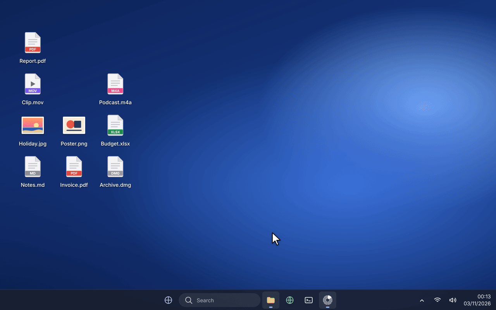

<p align="center">
  
</p>

# Split

Drag files, tap a key, drop them on a wheel of conversions and tools. A private, offline file converter and editor for Windows, living in the notification area.

On a Mac? **[Split for macOS](https://github.com/fabioAntGit/split)**.

<p align="center">
  
</p>

## Requirements

- Windows 10 22H2 (build 19045) or Windows 11, on x64 or arm64
- Nothing else for the program itself: it carries its own .NET runtime
- [winget](https://learn.microsoft.com/windows/package-manager/winget/) (part of Windows), only for audio and video, metadata removal and, without Office, the older Office formats

## Install

1. Download `Split-<version>-x64-Setup.exe` (or `-arm64-` on an ARM PC) from [Releases](https://github.com/fabioAntGit/split-windows/releases) and, if you like, check it against the `.sha256` file next to it:

   ```powershell
   (Get-FileHash .\Split-1.0.0-x64-Setup.exe).Hash.ToLower()
   ```

2. Run it. The release isn't code-signed (see below), so Windows shows **Windows protected your PC** the first time: click **More info**, then **Run anyway**. This is needed only once. The setup installs for you only, in `%LOCALAPPDATA%\Programs\Split`, and never asks for an administrator.
3. Install the free engines: in **Settings › Engines**, click **Install**, which opens a PowerShell window where winget downloads them. Or type the commands in a terminal yourself:

   ```powershell
   winget install -e --id Gyan.FFmpeg
   winget install -e --id OliverBetz.ExifTool
   ```

   There's no need to restart Split afterwards. Everything else is in the program.

4. Optional: choose **Add splitapp to PATH** in the setup, so `splitapp` works in a terminal.

The setup adds **Split** to the Start menu and to **Send to**, and **Open with Split** to the right-click menu of files and folders (on Windows 11 it is under **Show more options**). To uninstall, use **Settings › Apps**. It removes the program, the menu entries, the Send to shortcut, the PATH entry and the start-at-login value; your settings in `%APPDATA%\Split` stay.

### About the unsigned release

The setup on the Releases page is built by the author from this code, with `./make-installer.ps1`, and isn't signed with a code-signing certificate. That is why SmartScreen warns before the first run. There are two ways to go:

- **Accept the warning:** **More info › Run anyway**, once.
- **Build it yourself** from this code (see [Build and test](#build-and-test)). It's the same program, and one built on your own PC isn't marked as downloaded, so nothing warns.

On a PC with Smart App Control turned on, Windows may block unsigned programs without offering **Run anyway**.

## Use

1. Start dragging files (File Explorer, the desktop, a mail window…).
2. While still dragging, tap a key once:
   - **Shift**: the **conversion** wheel (formats)
   - **Ctrl**: the **tools** wheel (editors, compress, PDF, sound…)
   - **Alt**: the **actions** wheel (shelf, copy, copy paths, move, terminal)
3. Drop on the slice you want. The result is saved next to the original, which is never changed.

It also works without dragging: in the notification area, choose **Convert Files…**, **Tools…** or **Actions…** and then the files, or use **Open with Split** or **Send to › Split** in File Explorer. The wheel then follows the mouse (press highlights, release confirms) and the keyboard (arrows, Enter, Esc). Clicking outside closes it. The keys can be changed in **Settings › Shortcuts**.

Windows doesn't hand a drag from a program running as administrator to a normal one, so drag from a normal window.

### Groups

Slices that do similar things share one slice with three dots on its rim, for example **Compress** (compress, compress to a size, ZIP) or **Sound**. Click it, or rest on it for half a second while dragging, and it opens as a wheel of its own. **Esc**, **Backspace** or the centre go back.

### Settings › Wheels

The preview is the wheel itself, as saved, over your desktop picture. It always has the same size, so the slices are easy to arrange whatever size the wheel opens at.

- **Order:** drag a slice on the preview to where you want it, or drag a row from the list onto the slice whose place it should take. In the list, **Alt+↑/↓** moves the selected slices.
- **What a slice does:** click it, on the preview or in the list, to read what it does and for which files, and switch it off if you don't need it. Unticked slices don't appear.
- **Groups:** select slices (Ctrl-click or Shift-click) and click **Group**; **Ungroup** takes one apart. **Restore Defaults** brings back the original wheel.
- **Size:** from Extra Small to Extra Large. Icons always stay on one ring; a name too long for a small slice ends in “…”, and the centre shows it whole.
- **Names under icons:** turn it off for a wheel with icons only.
- **Color:** black (a soft black) or white, for the wheel, the editors and every other window.
- **Glass background:** the desktop shows through the wheel, blurred and tinted with that colour; **Intensity** goes from a light blur, where the desktop is still recognisable, to a heavy one, nearly solid. With Windows' **Transparency effects** off (Settings › Personalization › Colors) the wheel stays solid, and Settings says so with a button to that page.

## Editors

| Editor | For | What it does |
|---|---|---|
| Crop | Images | Fixed or free proportions, ready-made shapes for Instagram, Stories and Reels, YouTube, X, Facebook and LinkedIn (the shape only: pictures are never resized), rotate 90°, flip |
| Annotate and Cover | Images | Arrows, lines, shapes, text, numbers, highlighter; blur, pixelate or black out areas; blur faces automatically (Windows face detection) |
| Adjust | Images | Exposure, contrast, saturation, temperature and filters, with a before/after comparison |
| Add Background | Images | Padding, corners, shadow, gradients, colour or blurred image, output proportion |
| Collage | 2 or more images | Row, column or grid, spacing and background |
| Edit Media | Video and audio | Trim, speed, volume, fades, crop, rotate, cover areas, export a GIF, save frames |
| Organize PDF | PDF | Reorder, rotate, duplicate and delete pages, add other PDFs or images, extract pages |

Editors save a copy next to the original (for example `photo (cropped).jpg`). Closing with unsaved changes asks first.

## One-click tools

Compress (image, video, audio and PDF) or compress to a target size, remove metadata, remove background (a model that runs on your PC), combine into a PDF, split a PDF, extract archives, create a ZIP, normalize loudness (−16 LUFS, EBU R128), convert to mono, cut silences, remove audio, join videos, frames (12, at full resolution), audio to video (waveform MP4) and read QR codes (the text goes to the clipboard).

**Actions:** shelf (keeps files in a floating panel to drop later, or drag them all at once), copy, copy paths, move and open a terminal in the folder (Windows Terminal, or PowerShell without it).

**Activity…** in the notification area lists recent jobs and their results.

## What it converts

**Settings › Formats** answers the same per format: choose one to see what it turns into and what it's made from, with a dimmed name when a free program is still missing.

| From | To | Engine |
|---|---|---|
| JPG PNG WebP JPEG XL HEIC AVIF TIFF BMP GIF ICO SVG | JPG PNG WebP JPEG XL AVIF TIFF BMP GIF ICO PDF (GIF also to MP4/WebM) | Magick.NET, Svg.Skia |
| MP3 M4A WAV FLAC OGG Opus AIFF WMA | The same | ffmpeg |
| MP4 MOV M4V MKV WebM AVI WMV | MP4 MOV MKV WebM AVI WMV GIF and every audio format | ffmpeg |
| DOCX ODT RTF RTFD TXT HTML Markdown EPUB | PDF DOCX ODT RTF TXT HTML EPUB | Split's own readers and writers, Word (optional) |
| DOC | PDF DOCX ODT RTF TXT HTML EPUB | Word or LibreOffice |
| PDF | PNG JPG TXT DOCX RTF HTML EPUB | PDFium, with OCR (Windows) for scans |
| CSV TSV XLSX, and XLS ODS with Excel or LibreOffice | XLSX CSV TSV HTML PDF JSON | Split's own XLSX reader and writer, Excel (optional) |
| JSON | CSV TSV XLSX HTML XML YAML | Split's own |
| XML | JSON | Split's own |
| PPTX PPT ODP | PDF | PowerPoint or LibreOffice |
| SRT VTT | VTT SRT | ffmpeg |
| ZIP TAR TAR.GZ RAR 7Z | ZIP TAR TAR.GZ | SharpCompress |

The XLSX it writes keeps numbers, dates, percentages and formulas, with a bold header, a frozen first row and column widths. A European CSV (`;` and decimal comma) is read as such. Excel dates, including the 1904 date system, are converted correctly. When a conversion can't keep something (fonts, comments, animation), the result says what was lost.

## Look

- The wheel is black or white, and the slice under the pointer is lit by a soft platter of the wheel's ink, inset in its slice. The editors wear the same backdrop, and Settings and the other windows follow the same colour.
- With **Glass background** on, the wheel reads the screen behind it as it opens, blurs it and tints it. The picture stays in memory, is never saved, and goes with the wheel. Names keep a contrast of at least 4.5:1 whatever the desktop shows.
- Springs are critically damped and interruptible, the wheel opens at the pointer, and press highlights and release confirms. Sounds are a soft drop when a job is done, two lower ones on an error and a quiet tick as the pointer crosses the wheel, each kind with its own switch.
- Windows' **Animation effects**, **Transparency effects** and contrast themes are respected. Text on the highlight has a contrast of at least 4.5:1 in light and dark (checked by the tests).
- The interface is in English, Portuguese, French and Spanish.

## Errors explained

Every failure says what happened, why, and what to do. For example: the file was moved, is empty or is still only in OneDrive; the extension doesn't match the content (“it's a JPEG with a .png extension”); the disk is full; the folder can't be written to (permissions, a read-only disk, Controlled folder access); the video is incomplete; the PDF has a password; Office blocked a file from the web in Protected View; the archive tries to write outside its folder. The technical details are in a report that can be copied.

## Privacy and security

Split doesn't use the Internet, and the tests check it rather than just promise it:

- The program uses no networking API (HTTP, sockets, web clients), and the native libraries that ship with it link no network library, or are known not to use it.
- ffmpeg may only open local files (`-protocol_whitelist file`), so a playlist disguised as a video can't send it online.
- Before reading HTML, Markdown, EPUB, SVG and the “web pages” Word saves as `.doc`, Split removes everything in the document that points elsewhere, and inlines local stylesheets after cleaning them too.
- XML is read without external entities (no XXE) and with an expansion limit.
- Archives can't write outside their destination folder, and links that point outside it are dropped.
- File names never go through a shell.

The tests prove it with a local network tripwire: every hostile document points at it, and the result must be zero connections.

**Installing the engines** is the one time something goes online, and only when you click **Install** in Settings › Engines: winget runs in a PowerShell window you can see and downloads the program from its publisher. Split itself makes no connection.

**An exception you choose:** with “Use Word, Excel and PowerPoint when installed” on, those conversions are done by Microsoft's apps. The file never leaves the PC, but those apps follow their own rules and may, for example, load images or templates the document links to. Turn the option off to use only Split's own converters.

For the older Office formats without Office, LibreOffice is the free alternative:

```powershell
winget install -e --id TheDocumentFoundation.LibreOffice
```

## Terminal

With **Add splitapp to PATH** chosen in the setup, open a new terminal:

```powershell
splitapp convert webp $HOME\Desktop\*.heic
splitapp targets report.docx
splitapp tool compress video.mov
splitapp doctor
```

Without a command, `splitapp` starts the app.

## Build and test

You need the [.NET 10 SDK](https://dotnet.microsoft.com/download), ffmpeg for the tests (they make their audio and video samples with it), and [Inno Setup 6](https://jrsoftware.org/isinfo.php) only for the setup.

```powershell
./tools/get-model.ps1     # once: the background-removal model (about 170 MB, not in git)
./build.ps1               # builds everything (Release)
./test.ps1                # every test
./make-installer.ps1      # build/installer/Split-<version>-<arch>-Setup.exe and its .sha256, x64 and arm64
```

After `./build.ps1`, the program is `src\Split.App\bin\Release\net10.0-windows10.0.19041.0\Split.exe`. The first build downloads the NuGet packages once; after that, builds are offline. The version is `<Version>` in `Directory.Build.props`.

`./test.ps1` builds the app and the tests, generates every sample from scratch (nothing is downloaded) and runs 309 tests with about 96,000 checks:

- **Conversion:** every wheel format for every sample, and back again whenever the result's wheel offers the original's format, with the result's content checked (colours, pages, duration, codecs, text and accents).
- **Tools and editors:** compress, metadata, background, PDF, ZIP, loudness, silences, video and every editor.
- **Errors:** explanations for missing, empty, protected, damaged or disguised files.
- **Security:**
  - hostile HTML, Markdown, SVG, EPUB, DOCX and RTF, with zero network connections;
  - disguised playlists, XXE and “billion laughs”;
  - zip slip, file names with commands, and an audit of the program and its native libraries.
- **Interface:** the wheel's layout, groups, keyboard and mouse, springs, contrast, HUD, shelf, menus and shortcuts, plus snapshots of the windows in `build/test-run/_captures-windows`.
- **Localization:** every interface text is translated, and no translation is left unused.

Pass a filter to run only part of it, for example `./test.ps1 Security`. The Office tests open Word, Excel and PowerPoint, so they only run when asked:

```powershell
$env:SPLIT_OFFICE=1; ./test.ps1 Office
```

## Limitations

- HEIC is read but not written: Magick.NET carries no HEVC encoder. Compressing a HEIC gives a JPG.
- Pages, Numbers and Keynote files have no conversions; Split says so.
- DOC, XLS, ODS, PPTX, PPT and ODP need Word, Excel, PowerPoint or LibreOffice.
- Windows' Open box picks files or folders, never both, so in the notification area folders are chosen on their own. Dragging, Open with and Send to take both at once.

## Layout

| Folder | Contents |
|---|---|
| `src/Split.Core` | Formats, conversions, tools, editor models, jobs, output naming, engines, settings, errors, localization, wheel arrangement (no WPF) |
| `src/Split.Windows` | Windows integration: Explorer, terminal, faces, Office, sound, start at login, single instance |
| `src/Split.App` | The program: drag gesture, wheel, HUD, shelf, editors, settings, notification area, theme |
| `src/Split.Cli` | The `splitapp` command |
| `tests/Split.Tests` | Its own harness, generated samples and suites |
| `installer/` | The Inno Setup script |
| `tools/` | The model download, the fonts and icons check, and the tool that draws the app icon |
| `assets/`, `Resources/` | Fonts, the background-removal model and translations |

## Licenses

Split bundles these components:

| Component | Licence |
|---|---|
| [Inter](https://rsms.me/inter/) (font) | SIL OFL 1.1 (`assets/fonts/OFL.txt`) |
| [Fluent UI System Icons](https://github.com/microsoft/fluentui-system-icons) | MIT (`assets/fonts/LICENSE-FluentSystemIcons.txt`) |
| [Magick.NET](https://github.com/dlemstra/Magick.NET) (ImageMagick) | Apache-2.0 |
| [PDFsharp and MigraDoc](https://github.com/empira/PDFsharp) 6.2.4 | MIT (later versions are not, so this one is pinned) |
| [PDFium](https://pdfium.googlesource.com/pdfium/) binaries by bblanchon | Apache-2.0 / BSD-3-Clause |
| [ONNX Runtime](https://github.com/microsoft/onnxruntime) | MIT |
| IS-Net `isnet-general-use` model | Apache-2.0 |
| [SkiaSharp](https://github.com/mono/SkiaSharp) | MIT |
| [ZXing.Net](https://github.com/micjahn/ZXing.Net) | Apache-2.0 |
| [SharpCompress](https://github.com/adamhathcock/sharpcompress) | MIT |
| [AngleSharp](https://github.com/AngleSharp/AngleSharp) | MIT |
| [Svg.Skia](https://github.com/wieslawsoltes/Svg.Skia) | MIT |
| [H.NotifyIcon](https://github.com/HavenDV/H.NotifyIcon) | MIT |
| .NET runtime and WPF | MIT |

ffmpeg, ExifTool and LibreOffice are not bundled: they are separate programs you install yourself, under their own licences.
